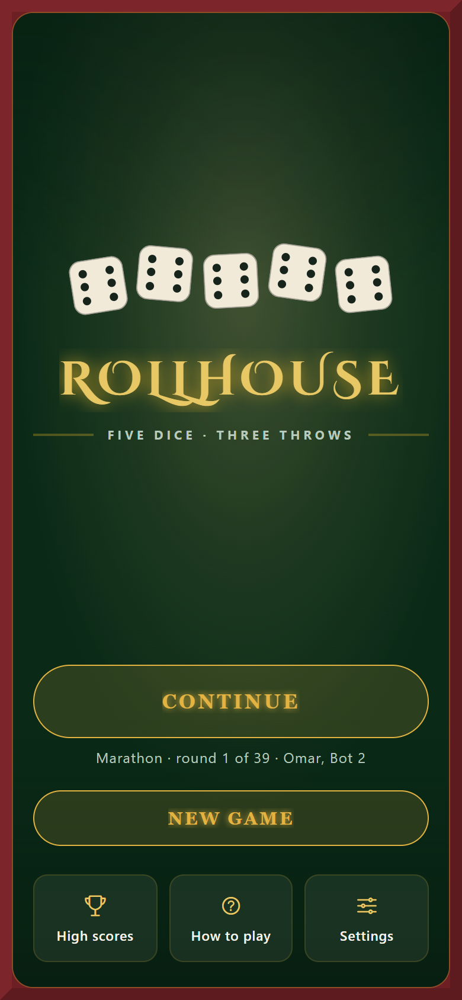
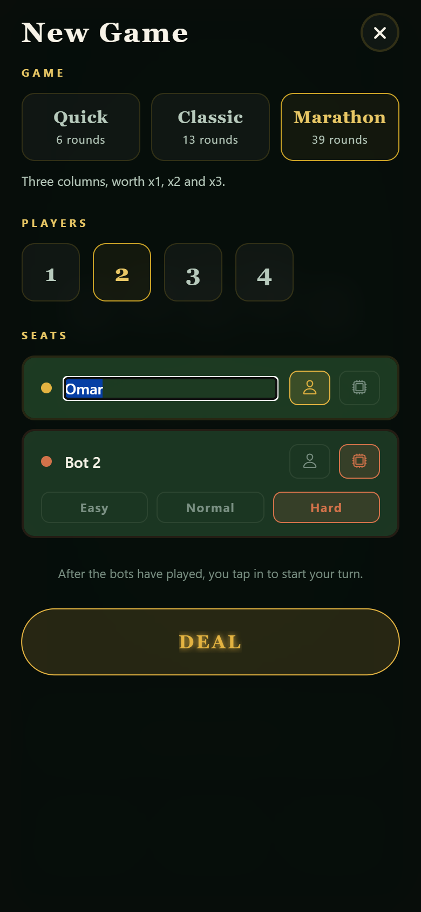
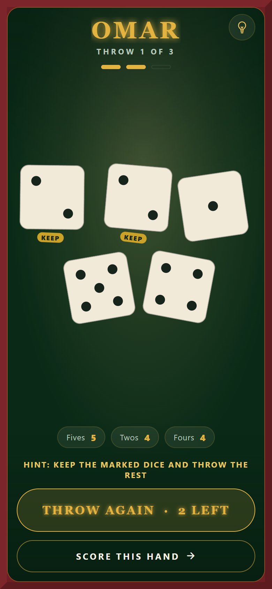
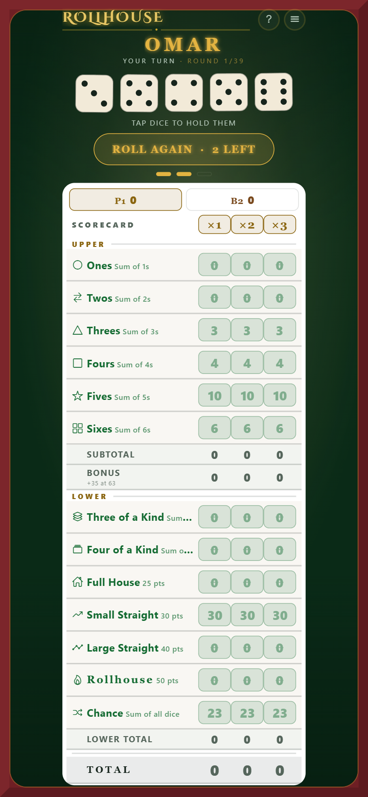

# Rollhouse

A five-dice, three-roll classic for one to four players, built with Expo and
React Native. Play alone for a high score, pass-and-play on one device, or
against bots.

- **Three game types** — Quick (upper section, 6 rounds), Classic (the full
  card, 13 rounds) and Marathon (three columns worth x1, x2 and x3, 39 rounds)
- **Shake to throw** — each turn opens on a page of nothing but the dice;
  shake the phone (or tap) to roll, then head to the table to score
- **Full standard rules**, including the 100-point bonus for every extra
  Rollhouse (five alike) and the Joker rule that goes with it
- **Bots at three levels** — Easy, Normal and Hard, averaging roughly 195, 225
  and 240 in a Classic game
- **1–4 players**, any mix of people and bots, with your own names
- **High scores** per game type, a running record and achievements
- **Hints** on request, from the Hard bot; a hinted game is marked as one
- **Sound, vibration, bot speed** and the rest, in Settings
- **Undo**, so a mis-tapped category is recoverable
- Games **survive being closed**, and the menu offers to continue them
- Tests over the rules engine, the bots, persistence and the UI

| Menu | New game | Throw | Marathon |
|---|---|---|---|
|  |  |  |  |

More in [docs/screenshots](docs/screenshots).

---

## Play it

There is no public build yet. To try it:

- **In a browser:** `npm install`, then `npm run web`.
- **On a phone:** `npm start`, then scan the code it prints with
  [Expo Go](https://apps.apple.com/app/expo-go/id982107779) (iPhone) or the
  Expo Go app (Android). Expo Go must be **SDK 54**.

Shaking to throw, vibration and sound only work on a phone.

---

## Developing

```bash
npm install
npm start          # Metro, then open in Expo Go
npm run web        # or run it in a browser
```

Checks, all of which CI also runs on every push:

```bash
npm run verify     # typecheck, lint, and the full test suite
npm test
npm run typecheck
npm run lint
```

### Shipping changes to testers

JavaScript-only changes reach everyone in seconds, on both platforms, with no
rebuild and no reinstall:

```bash
npx eas update --branch preview --message "what changed"
```

Native changes — a new package, an SDK bump — need a fresh build:

```bash
npx eas build --platform android --profile preview
node scripts/make-qr.js --apk <the new Application Archive URL>
```

`make-qr.js` writes tester QR codes into `docs/`: one that opens the latest
update in Expo Go, and one that downloads that Android build. The Android code
points at one specific build, so regenerate it after each one.

On Windows PowerShell, use `npx.cmd` rather than `npx`.

---

## How it is put together

```
App.tsx          picks between the menu and a game; owns the sheets over both
src/logic/       pure TypeScript: rules, game types, scoring, bots,
                 persistence, stats, high scores, settings
src/hooks/       the seam between that and React: the game, settings, shake
src/screens/     every full screen: menu, game, dice page, new game, rules,
                 high scores, settings, results
src/components/  the pieces those are built from: dice, scorecard, buttons
src/storage.ts   the only module that reads or writes the device
src/feedback.ts  sound and vibration
src/theme.ts     colours, type and spacing
assets/          icons, splash and the generated sound effects
scripts/         make-sounds.js and make-qr.js
```

Tests sit beside the file they cover, as `*.test.ts(x)`.

`src/logic` imports nothing from React or React Native, which is why the rules
engine and the AI can be tested headlessly and why the AI could be built and
measured before any of it was wired to a screen.

### Two knobs worth knowing about

**`src/layout.ts`** holds the board's one real tension. Thirteen score rows plus
dice, a roll button and totals do not fit a phone at a comfortable finger size,
so row height and the auto-fit scale floor move together as a single choice:

| | rows | scale floor | result |
|---|---|---|---|
| `compact` | ~30px | 0.72 | fits iPhone 14 and up, no scrolling |
| `roomy` | ~38px | 0.85 | scrolls on phones, easier to tap |

**`src/theme.ts`** is the whole visual system — palette, seat colours, spacing,
type. The casino table look lives here and nowhere else.

**`src/logic/modes.ts`** is the one table that says what differs between game
types: which boxes are in play and how many columns the card has. Adding a
game type is a row there.

**`scripts/make-sounds.js`** synthesises the sound effects into
`assets/sounds/`. They are generated rather than sourced, so retuning one is a
matter of editing numbers and re-running `node scripts/make-sounds.js`.
